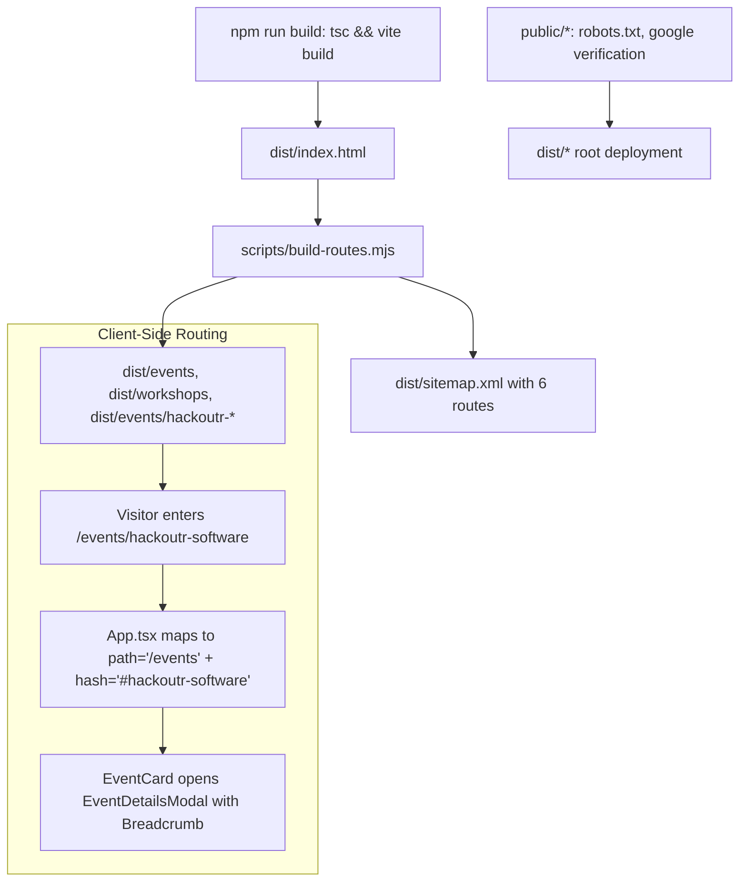

# Technical SEO, Sitemap, and Indexing Operations Manual
**Target Project:** HackFest 2026 (`hackfest.outrb.tech`)  
**Stack:** Vite + React (TypeScript) + GitHub Pages Static Routing  
**Format:** Dual-Purpose (Human-Readable Manual & Token-Dense LLM Context)

---

## 1. Architectural & Coding Decisions (Rationale Matrix)

### Choice 1: Lightweight Post-Build Pre-rendering vs Heavy Framework Migration
* **Decision**: Wrote a custom Node.js post-build script ([`scripts/build-routes.mjs`](file:///c:/Users/LOQ/.gemini/antigravity-ide/scratch/HackFest-1.0/scripts/build-routes.mjs)) instead of rewriting the project into Next.js, Remix, or Astro.
* **Rationale**: 
  - Zero disruption to existing Vite + React configuration and zero added runtime dependencies.
  - Generates dedicated static entry folders (`dist/events/index.html`, `dist/events/hackoutr-software/index.html`, etc.) that reuse Vite's existing bundled JS/CSS chunks.
  - Solves the GitHub Pages single-page reload `404` error without requiring hacky redirect workarounds like `404.html` query string routers.
  - Allows injecting unique `<title>`, `<meta description>`, Open Graph tags, canonical links, and Schema.org JSON-LD directly into the HTML delivered to Googlebot.

### Choice 2: Native SPA Route Resolution vs External Router Library
* **Decision**: Implemented native `window.location.pathname` and `window.location.hash` mapping inside [`src/App.tsx`](file:///c:/Users/LOQ/.gemini/antigravity-ide/scratch/HackFest-1.0/src/App.tsx) instead of introducing `react-router-dom`.
* **Rationale**:
  - Saved ~30kB of client bundle size and avoided unnecessary router context providers.
  - Direct routes `/events/hackoutr-software` and `/events/hackoutr-hardware` map cleanly to the `/events` catalog while auto-setting `window.location.hash` (`#hackoutr-software`, `#hackoutr-hardware`).
  - Seamlessly triggers the existing event modal listener in `EventCard.tsx` without triggering a full page re-render.

### Choice 3: Unified Breadcrumb UX & Redundancy Removal
* **Decision**: Created [`src/components/ui/Breadcrumb.tsx`](file:///c:/Users/LOQ/.gemini/antigravity-ide/scratch/HackFest-1.0/src/components/ui/Breadcrumb.tsx) and removed both the legacy eyebrow (`HACKFEST 2026 // 01 / ALL EVENTS`) and the redundant `← BACK TO HOME` link.
* **Rationale**:
  - Eliminates visual clutter: Previously, "HACKFEST 2026" appeared 3 separate times in a 40px vertical stack.
  - Polymorphic navigation: Supports both standard `href` anchors (for cross-page navigation) and `onClick` handlers (allowing category filter resets within `/events` without losing client state).
  - Dual-theming: `theme="light"` for the brutalist yellow catalog header, and `theme="dark"` for the cyberpunk dark modal shell.
  - Semantic accessibility: Strict `<nav aria-label="Breadcrumb"><ol><li>...</li></ol></nav>` with `aria-current="page"` on leaf nodes.

### Choice 4: Schema.org Standalone Sub-Event Modeling
* **Decision**: Explicitly defined full properties (`location`, `organizer`, `performer`, `offers`, `image`) on both parent event (`HACKFEST 2026`) and every `subEvent` (`HackOUTR Software/Hardware`).
* **Rationale**:
  - Google's Rich Results validator does not inherit parent event properties to sub-events. Omitting `location` inside a sub-event results in a critical validation error, disqualifying the entire page from Google Event carousels.
  - Defining `performer: { "@type": "Organization", "name": "TeCHSoC, OUTR" }` clears Google's optional performer warning for hackathons.
  - Accurate pricing (`499 INR`) and direct registration Google Form URLs provide rich ticket metadata directly on Google Search.

### Choice 5: Static HTML File Verification over DNS TXT
* **Decision**: Placed `public/google[id].html` into Vite's public asset directory instead of adding a DNS TXT record.
* **Rationale**:
  - Under DNS standard RFC 1912 §2.4, a `CNAME` record cannot coexist with any other record (including `TXT`) on the exact same subdomain name (`hackfest`).
  - Attempting to add a TXT record on `hackfest.outrb.tech` could either be rejected by the DNS registrar or break CNAME traffic resolution to GitHub Pages.
  - Static HTML verification is 100% risk-free to existing DNS traffic.

---

## 2. System Architecture Flow



---

## 3. Directory Structure & File Responsibilities

| Path | Purpose |
|---|---|
| `public/robots.txt` | Directs web crawlers and specifies the sitemap endpoint. |
| `public/google[id].html` | Instant ownership verification file for Google Search Console. |
| `scripts/build-routes.mjs` | Node script generating `sitemap.xml`, canonical links, and JSON-LD static entries. |
| `index.html` | Root HTML template containing global Schema.org `@graph`, Open Graph, and Geo tags. |
| `src/components/ui/Breadcrumb.tsx` | Reusable, dual-themed brutalist breadcrumb component. |
| `src/pages/CatalogPage.tsx` | Hub catalog with dynamic category breadcrumb updates. |
| `src/components/events/EventDetailsModal.tsx` | Modal dialog displaying hierarchical navigation trail. |
| `src/App.tsx` | Direct routing & state controller for deep links. |

---

## 4. Code Implementation Patterns

### Pattern A: Build-Time Route & Sitemap Generation
From [`scripts/build-routes.mjs`](file:///c:/Users/LOQ/.gemini/antigravity-ide/scratch/HackFest-1.0/scripts/build-routes.mjs):
```javascript
const BASE_URL = (process.env.SITE_URL || 'https://hackfest.outrb.tech').replace(/\/$/, '');
const routes = {
  events: { title: 'Competitions', priority: '0.9', changefreq: 'daily', ... },
  'events/hackoutr-software': { title: 'HackOUTR Software Edition', priority: '0.95', ... },
  'events/hackoutr-hardware': { title: 'HackOUTR Hardware Edition', priority: '0.95', ... },
  'fun-events': { title: 'Fun Events', priority: '0.8', ... },
  workshops: { title: 'Workshops', priority: '0.8', ... }
};

// Generates route folders, injects BreadcrumbList JSON-LD & canonical tags, and creates sitemap.xml
```

### Pattern B: Schema.org Event & Sub-Event Validation
From [`index.html`](file:///c:/Users/LOQ/.gemini/antigravity-ide/scratch/HackFest-1.0/index.html):
```json
{
  "@context": "https://schema.org",
  "@graph": [
    {
      "@type": "Event",
      "@id": "https://hackfest.outrb.tech/#event",
      "name": "HACKFEST 2026",
      "startDate": "2026-11-04T09:00:00+05:30",
      "endDate": "2026-11-06T18:00:00+05:30",
      "eventAttendanceMode": "https://schema.org/OfflineEventAttendanceMode",
      "eventStatus": "https://schema.org/EventScheduled",
      "location": {
        "@type": "Place",
        "name": "Odisha University of Technology and Research (OUTR)",
        "address": {
          "@type": "PostalAddress",
          "streetAddress": "Ghatikia, Mahalaxmi Vihar",
          "addressLocality": "Bhubaneswar",
          "addressRegion": "Odisha",
          "postalCode": "751029",
          "addressCountry": "IN"
        }
      },
      "subEvent": [
        {
          "@type": "Event",
          "name": "HackOUTR Software Edition",
          "startDate": "2026-11-04T14:00:00+05:30",
          "endDate": "2026-11-06T14:00:00+05:30",
          "eventAttendanceMode": "https://schema.org/OfflineEventAttendanceMode",
          "eventStatus": "https://schema.org/EventScheduled",
          "location": { "@type": "Place", "name": "OUTR", ... },
          "offers": { "@type": "Offer", "price": "499", "priceCurrency": "INR", ... }
        }
      ]
    }
  ]
}
```

---

## 5. Troubleshooting & Debugging Reference

| Issue | Root Cause | Solution |
|---|---|---|
| **Site not showing for target queries** | Canonical URLs pointed to temporary staging domain (`motabhai2005.github.io`) | Point all canonical `<link>`, `og:url`, and sitemaps to `https://hackfest.outrb.tech`. |
| **Google Rich Results Error: "Missing field location"** | Sub-events did not define their own `location` block | Replicate full `Place` definition inside every item in `subEvent`. |
| **DNS conflict when adding TXT record** | Subdomain already configured with a `CNAME` record | Switch verification method to static HTML file upload in `public/`. |
| **Header text repetition** | Static eyebrow + back link + breadcrumb all active simultaneously | Remove legacy eyebrow and back button; make breadcrumb root linkable. |

---

## 6. Ranking Acceleration Playbook (#1 on Google)

1. **Submit Sitemap**: In Google Search Console, submit `sitemap.xml` under **Sitemaps**.
2. **Request Priority Crawl**: In the URL Inspection bar, submit `https://hackfest.outrb.tech/` and `https://hackfest.outrb.tech/events`.
3. **Pass Authority via Unstop Listing**: Add `https://hackfest.outrb.tech` as the official website on the top-ranking Unstop listing.
4. **Acquire University Backlink**: Link from `outr.ac.in` to inherit `.ac.in` institutional domain authority.
5. **Inspect Live Crawl**: Search `site:hackfest.outrb.tech` on Google to verify indexed documents.
